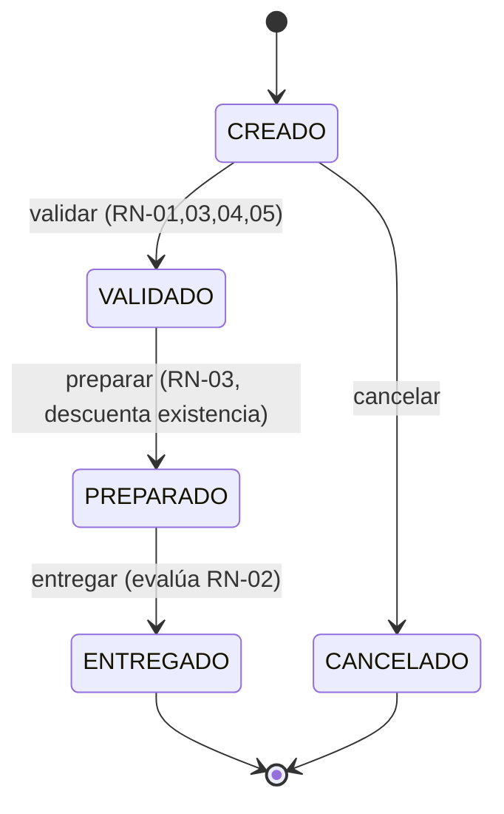

# FarmaExpress — Business Requirements Document (BRD) final · v2.0

| | |
|---|---|
| **Curso** | Componentes de Lógica de Negocios · FIME-UANL · Producto Integrador de Aprendizaje |
| **Equipo 10** | Arleth García Martínez (2145524) · Ángel Mauricio Castruita Márquez (2146281) · Carlos Patricio Lozano Treviño (2147049) |
| **Versión** | 2.0 (final para PIA) · 04/11/26 · sustituye al BRD v1 del 04/09/26 |
| **Qué cambió** | Se conservan **sin modificar** todos los IDs de v1 (BN-01…BN-10, US-01…US-18). Se **agrega** el §9 "Incremento PIA" con BN-11…BN-14, US-19…US-26 y reglas RN-01…RN-09. |

> **Cómo leer este documento.** Las secciones 1–8 son el BRD v1 del equipo, íntegro. La sección 9 es el refinamiento
> exigido por el PIA ("integrar y refinar los productos previos"): define el **pedido de farmacia** como la formalización
> de la venta en mostrador y es la base directa del código. La matriz BRD → regla → componente → prueba está en
> [`trazabilidad.md`](trazabilidad.md).

---

## 1. Contexto
FarmaExpress es una cadena de farmacias con varias sucursales que vende medicamentos y artículos de cuidado personal,
operando bajo control de inventario por producto, lote y fecha de caducidad. El proceso central del negocio abarca la
venta en mostrador, la validación de recetas para medicamentos controlados, el control de inventario y el resurtido ante
proveedores.

## 2. Problema
- Los niveles mínimos de inventario se calculan manualmente, sin una fórmula estandarizada, lo que genera resurtidos reactivos.
- La detección de productos próximos a caducar es tardía, generando merma evitable.
- No existe visibilidad de inventario entre sucursales, lo que impide canalizar ventas o transferir producto de forma ágil.
- Los retiros de lote dependen de un proceso manual que retrasa el bloqueo de venta en todas las sucursales.

## 3. Objetivos del proyecto
- Reducir los quiebres de stock mediante cálculo automático del punto de reorden.
- Reducir la merma por caducidad mediante alertas tempranas (90/60/30 días).
- Reducir el tiempo de respuesta ante retiros de lote.
- Dar visibilidad de inventario entre sucursales para consultas y transferencias.

## 4. Alcance
**Dentro del alcance (negocio):**
- Proceso de venta en mostrador, incluyendo validación de recetas para medicamentos controlados.
- Control de inventario por lote y caducidad, con alertas automáticas.
- Proceso de resurtido: detección de mínimos, generación de orden de compra y recepción en almacén.
- Consulta de inventario entre sucursales y transferencias autorizadas.
- Reportes de ventas, caducidades, quiebres de stock y diferencias de inventario.

**Fuera de alcance (a validar con el stakeholder):**
- Integración directa con sistemas de facturación fiscal (se asume que ya existe un sistema externo).
- Comercio electrónico / venta en línea.
- Gestión de nómina o recursos humanos del personal de farmacia.

> El alcance **de implementación del PIA** (qué parte de lo anterior se programa en este incremento) se define en el §9.1.

## 5. Stakeholders
| Rol | Interés / responsabilidad |
|---|---|
| Cliente | Recibir el producto correcto, con existencia y dentro de vigencia; recibir alternativas cuando no hay stock. |
| Cajero | Ejecutar la venta cumpliendo las validaciones de receta, existencia y caducidad. |
| Responsable de farmacia | Autorizar excepciones (controlados, sustituciones, retiros, ajustes de inventario); cumplir regulación sanitaria. |
| Compras | Generar resurtido oportuno con base en alertas de mínimos; gestionar órdenes de compra. |
| Almacén | Recibir mercancía, actualizar inventario, ejecutar recolección de lotes retirados. |
| Gerencia / Dirección | Tomar decisiones con base en reportes de ventas, merma y quiebres de stock. |

## 6. Necesidades del negocio (v1)
| ID | Necesidad |
|---|---|
| BN-01 | Validar automáticamente que la receta de un medicamento controlado esté completa y vigente antes de vender. |
| BN-02 | Impedir la venta de productos caducados o de lotes retirados. |
| BN-03 | Calcular el punto de reorden de cada producto por sucursal con base en su rotación histórica. |
| BN-04 | Generar alertas automáticas de resurtido cuando la existencia cae por debajo del mínimo. |
| BN-05 | Alertar productos próximos a caducar en umbrales de 90, 60 y 30 días. |
| BN-06 | Permitir bloquear en todas las sucursales, de forma inmediata, un lote retirado por el proveedor o la autoridad. |
| BN-07 | Dar visibilidad de inventario entre sucursales para consulta y transferencia de producto. |
| BN-08 | Registrar y justificar diferencias entre inventario físico y registrado (conteo cíclico). |
| BN-09 | Generar reportes de ventas, caducidades, quiebres de stock y diferencias de inventario. |
| BN-10 | Restringir por rol quién puede autorizar ventas de controlados, sustituciones, retiros y ajustes de inventario. |

## 7. Restricciones, supuestos y criterios de éxito (v1)
**Restricciones**
- El sistema debe cumplir la regulación sanitaria vigente aplicable a medicamentos controlados (validar marco legal exacto con el stakeholder / asesor legal).
- La solución debe operar de forma consistente en todas las sucursales (bloqueo de lotes en tiempo cercano al real).
- Ninguna venta de medicamento controlado puede completarse sin receta validada.

**Supuestos**
- Existe conectividad entre sucursales para sincronizar inventario y alertas (a confirmar).
- Compras tiene autoridad para generar órdenes de compra sin aprobación adicional de Gerencia, salvo que se indique lo contrario.
- Umbral de diferencia de inventario del 2 % como referencia inicial; debe validarse con el stakeholder.

**Criterios de éxito**
- Reducción medible de quiebres de stock por sucursal en un periodo definido (meta a validar).
- Reducción medible de merma por caducidad.
- Tiempo entre alerta de retiro de lote y bloqueo efectivo en todas las sucursales menor a un umbral definido (minutos, no días).
- 100 % de ventas de medicamentos controlados con receta validada registrada.

## 8. Historias de usuario v1 (resumen; Gherkin completo en el documento *User Stories* del equipo)
| ID | Como… quiero… | BN |
|---|---|---|
| US-01 | Cajero: registrar la venta de un producto sin restricciones | — |
| US-02 | Cajero: que el sistema solicite los datos de la receta (paciente, médico, cédula, fecha de emisión) en controlados | BN-01 |
| US-03 | Cajero: que se rechace una receta vencida (> 30 días) o incompleta | BN-01 |
| US-04 | Responsable: autorizar ventas de controlados que excedan 10 piezas o $3,000 MXN | BN-10 |
| US-05 | Cajero: ofrecer un producto sustituto cuando no hay existencia | — |
| US-06 | Responsable: autorizar toda sustitución de un controlado | BN-10 |
| US-07 | Sistema de inventario: bloquear la venta de productos caducados | BN-02 |
| US-08 | Responsable: bloquear en todas las sucursales un lote retirado | BN-02, BN-06 |
| US-09 | Sistema de inventario: alertas de caducidad a 90, 60 y 30 días | BN-05 |
| US-10 | Responsable: decidir qué hacer con un producto próximo a caducar | BN-05 |
| US-11 | Sistema de inventario: calcular el punto de reorden por rotación | BN-03 |
| US-12 | Compras: alerta automática cuando un producto cae bajo su mínimo | BN-04 |
| US-13 | Compras: generar orden de compra desde las alertas | BN-04 |
| US-14 | Almacén: registrar la recepción de mercancía contra la orden de compra | BN-04 |
| US-15 | Cajero: consultar existencia en sucursales cercanas | BN-07 |
| US-16 | Responsable: autorizar transferencias entre sucursales | BN-07 |
| US-17 | Responsable: registrar y justificar diferencias de conteo cíclico (> 2 %) | BN-08 |
| US-18 | Gerencia: consultar reportes de ventas, caducidades, quiebres y diferencias | BN-09 |

*(La columna BN es la relación temática que usa la trazabilidad; v1 no la declaraba explícitamente.)*

---

# 9. Incremento PIA — Pedido de farmacia (refinamiento v2)

## 9.1 Alcance de implementación del PIA
El PIA implementa un **corte vertical** del negocio: el ciclo de vida de un **pedido** (la venta formalizada),
con sus reglas, estados, eventos y API. Se eligió porque es el eje que conecta las demás capacidades del BRD
(descuento de inventario, receta, autorización) y el que permite demostrar DDD, Specification y máquina de estados.

| Capacidad del BRD v1 | En el PIA |
|---|---|
| Venta formalizada, validación de existencia y autorización (US-01, US-04) | **Sí** (BN-11, BN-12) |
| Receta vigente ≤ 30 días en controlados (US-03) | **Parcial** (vigencia; no datos completos) |
| Pedido con estados, cancelación y auditoría | **Sí** (BN-11, BN-14) |
| Beneficio comercial de referencia | **Sí** (BN-13) |
| Lotes, caducidad, retiros (BN-02, BN-05, BN-06) · resurtido (BN-03, BN-04) · sustitución · transferencias · conteo · reportes | **No — backlog** (§9.6) |

## 9.2 Necesidades del negocio nuevas
| ID | Necesidad | Refina |
|---|---|---|
| BN-11 | Gestionar el ciclo de vida de un pedido de farmacia: **CREADO → VALIDADO → PREPARADO → ENTREGADO**, con cancelación alternativa **CREADO → CANCELADO**, sin permitir saltos ni repeticiones. | Alcance: "venta en mostrador" |
| BN-12 | Validar antes de procesar un pedido: comprador activo, detalle no vacío, autorización, productos habilitados y existencia suficiente; y, en controlados, receta vigente y autorización por límite. | BN-01, BN-10, US-01, US-03, US-04 |
| BN-13 | Identificar los pedidos con **beneficio de referencia**: comprador preferente, total ≥ $1,500 MXN y sin promoción activa. | Criterio comercial (supuesto S-1) |
| BN-14 | Dejar registro auditable de cada cambio de estado del pedido (quién/qué/cuándo) para reportes y para disparar procesos posteriores (p. ej. resurtido). | Criterios de éxito; US-12 |

## 9.3 Supuestos y restricciones del incremento
| ID | Supuesto / restricción | Estado |
|---|---|---|
| S-1 | El umbral de beneficio ($1,500 MXN) y la regla "sin promoción activa" provienen del paquete de datos del PIA; se adoptan como política comercial de FarmaExpress. | A validar con el stakeholder |
| S-2 | "Autorizado" en el pedido equivale a la autorización del Responsable de farmacia (BN-10); el control por rol/identidad queda en backlog. | Adoptado |
| S-3 | La existencia se controla por producto (no por lote) en este incremento. | Adoptado |
| S-4 | Un pedido sólo se cancela desde CREADO (no hay devolución de existencia). | Adoptado |
| R-1 | Todos los importes en MXN con 2 decimales (`Decimal`, nunca `float`); cantidades enteras > 0. | Restricción |
| R-2 | Un pedido de controlados no puede validarse sin receta vigente (restricción del BRD v1 §7). | Restricción |

## 9.4 Reglas de negocio
| ID | Regla | Implementación (Specification / componente) |
|---|---|---|
| RN-01 | Un pedido **puede procesarse** si comprador **activo** ∧ detalle **no vacío** ∧ **autorizado**. | `PUEDE_PROCESARSE` = `ActorActivo & DetalleNoVacio & Autorizado` |
| RN-02 | Hay **beneficio de referencia** si comprador **preferente** ∧ total **≥ 1,500** ∧ **¬** promoción activa. | `BENEFICIO_REFERENCIA` = `ActorPreferente & TotalMinimo(1500) & ~PromocionActiva` |
| RN-03 | Cada producto del pedido debe estar **habilitado** y tener **existencia ≥ cantidad** (se revalida al preparar). | `ProductosHabilitados`, `StockSuficiente` |
| RN-04 | En controlados, la receta debe existir y tener **≤ 30 días**. | `VENTA_CONTROLADA_CON_RECETA` = `~ContieneControlado | RecetaVigente` |
| RN-05 | En controlados, si el pedido excede **10 piezas** o **$3,000**, exige autorización. | `LIMITE_CONTROLADO_AUTORIZADO` = `~(ContieneControlado & ExcedeLimiteControlado) | Autorizado` |
| RN-06 | Sólo existen 4 transiciones legales: validar (CREADO→VALIDADO), preparar (→PREPARADO), entregar (→ENTREGADO), cancelar (CREADO→CANCELADO). | `MaquinaDeEstados` (tabla) |
| RN-07 | Precedencia de errores: dato inválido (400) → inexistente (404) → transición ilegal (409) → regla de negocio (422). | `api/errores.py`, `Pedido.validar/preparar` |
| RN-08 | Importe = Σ(precio × cantidad) con precisión de centavos; el precio de cada línea es el del catálogo al momento de agregarla. | `Dinero`, `Cantidad`, `LineaPedido` |
| RN-09 | Cada cambio de estado emite un evento de dominio, se guarda con el pedido en la misma transacción y se publica sólo tras confirmar. | `events.py`, `ServicioPedidos._persistir` |



## 9.5 Historias de usuario nuevas (Gherkin)
Se suman a las 18 del §8: **26 historias en total** (el PIA pide ≥ 15).

**US-19 — Registrar un pedido.** Como *Cajero*, quiero registrar un pedido a nombre de un comprador con sus productos y cantidades, para formalizar la venta con un total calculado.
```gherkin
Escenario: Pedido válido
  Dado un comprador existente y productos del catálogo
  Cuando registro el pedido con líneas de cantidad entera mayor a cero
  Entonces el pedido queda en estado CREADO
  Y el total es la suma de precio × cantidad en MXN con dos decimales

Escenario: Cantidad inválida
  Dado un pedido con una línea de cantidad 0 o negativa
  Cuando intento registrarlo
  Entonces el sistema responde 400 y no crea el pedido

Escenario: Referencias inexistentes
  Dado un comprador o producto que no existe
  Cuando intento registrar el pedido
  Entonces el sistema responde 404
```

**US-20 — Validar un pedido.** Como *Cajero*, quiero validar un pedido, para confirmar que puede procesarse antes de prepararlo.
```gherkin
Escenario: Validación exitosa
  Dado un pedido CREADO de comprador activo, con detalle, autorizado,
       con productos habilitados y existencia suficiente
  Cuando lo valido
  Entonces pasa a VALIDADO y se registra el evento PedidoValidado
```

**US-21 — Conocer el motivo de un rechazo.** Como *Cajero*, quiero ver qué reglas incumple un pedido, para corregirlo o informar al cliente.
```gherkin
Escenario: Rechazo con motivos
  Dado un pedido CREADO de comprador inactivo, sin autorización, o con producto sin existencia o deshabilitado
  Cuando intento validarlo
  Entonces el sistema responde 422 con la lista de reglas incumplidas
  Y el pedido permanece en CREADO

Escenario: Medicamento controlado sin receta vigente
  Dado un pedido con un medicamento controlado y receta de más de 30 días o ausente
  Cuando intento validarlo
  Entonces el sistema responde 422 indicando "receta_vigente"

Escenario: Controlado sobre el límite
  Dado un pedido con controlado de más de 10 piezas o más de $3,000 MXN sin autorización
  Cuando intento validarlo
  Entonces el sistema responde 422 y lo mantiene en CREADO
```

**US-22 — Preparar un pedido.** Como *Almacén*, quiero preparar un pedido validado, para descontar la existencia y dejarlo listo para entregar.
```gherkin
Escenario: Preparación con existencia
  Dado un pedido VALIDADO y existencia suficiente de cada producto
  Cuando lo preparo
  Entonces la existencia de cada producto se reduce en la cantidad pedida
  Y el pedido pasa a PREPARADO con el evento PedidoPreparado

Escenario: Existencia agotada entre validar y preparar
  Dado un pedido VALIDADO cuya existencia ya no alcanza
  Cuando intento prepararlo
  Entonces el sistema responde 422, no descuenta nada y el pedido sigue VALIDADO
```

**US-23 — Entregar y reconocer el beneficio.** Como *Cajero*, quiero entregar un pedido preparado, para cerrar la venta y saber si aplica el beneficio de referencia.
```gherkin
Escenario: Entrega con beneficio
  Dado un pedido PREPARADO de comprador preferente, total >= 1500 y sin promoción activa
  Cuando lo entrego
  Entonces pasa a ENTREGADO y el evento PedidoEntregado marca beneficio_referencia = verdadero

Escenario: Entrega sin beneficio
  Dado un pedido PREPARADO con total de 1499.99, o con promoción activa, o de comprador no preferente
  Cuando lo entrego
  Entonces pasa a ENTREGADO y beneficio_referencia = falso
```

**US-24 — Cancelar un pedido.** Como *Cajero*, quiero cancelar un pedido que aún no se valida, para anular una venta que el cliente no confirma.
```gherkin
Escenario: Cancelación permitida
  Dado un pedido en estado CREADO
  Cuando lo cancelo
  Entonces pasa a CANCELADO y se registra PedidoCancelado

Escenario: Cancelación no permitida
  Dado un pedido VALIDADO, PREPARADO o ENTREGADO
  Cuando intento cancelarlo
  Entonces el sistema responde 409 y no cambia su estado
```

**US-25 — Impedir transiciones inválidas.** Como *Responsable de farmacia*, quiero que el sistema impida saltar pasos o repetir aprobaciones, para garantizar que ningún pedido se entrega sin haberse validado y preparado.
```gherkin
Escenario: Saltar de estado
  Dado un pedido CREADO
  Cuando intento entregarlo directamente
  Entonces el sistema responde 409 y el pedido sigue CREADO

Escenario: Repetir aprobación
  Dado un pedido ya VALIDADO
  Cuando intento validarlo otra vez
  Entonces el sistema responde 409 y no emite un segundo evento
```

**US-26 — Consultar la bitácora de un pedido.** Como *Responsable de farmacia*, quiero consultar los eventos de un pedido, para auditar qué ocurrió y cuándo.
```gherkin
Escenario: Bitácora completa
  Dado un pedido que fue creado, validado, preparado y entregado
  Cuando consulto sus eventos
  Entonces veo PedidoCreado, PedidoValidado, PedidoPreparado y PedidoEntregado en ese orden, con fecha y datos

Escenario: Sin eventos fantasma
  Dado una operación que falló por una regla de negocio
  Cuando consulto los eventos
  Entonces no aparece ningún evento de esa operación fallida
```

## 9.6 Brecha y backlog priorizado (lo que el BRD v1 pide y el PIA aún no programa)
| Prioridad | Incremento | Cubre | Por qué en ese orden |
|---|---|---|---|
| 1 | Value Object `Receta` completa (paciente, médico, cédula, fecha) | US-02, US-03 | Cierra BN-01 y la restricción "ningún controlado sin receta validada"; es cambio chico. |
| 2 | Agregado `Lote` con caducidad y estado (bloqueado/retirado) | BN-02, BN-06, US-07, US-08 | Reemplaza `stock` por lote; habilita FEFO. |
| 3 | Resurtido como suscriptor de `PedidoPreparado` | BN-03, BN-04, US-11, US-12, US-13 | Los eventos ya existen; sólo faltan manejadores y la orden de compra. |
| 4 | Roles e identidad del autorizador | BN-10, US-04, US-06 | Sustituye la bandera `autorizado`. |
| 5 | Sustitución, transferencias, conteo y reportes | US-05, US-06, US-14…US-18, BN-07…BN-09 | Dependen de lotes y sucursales. |
