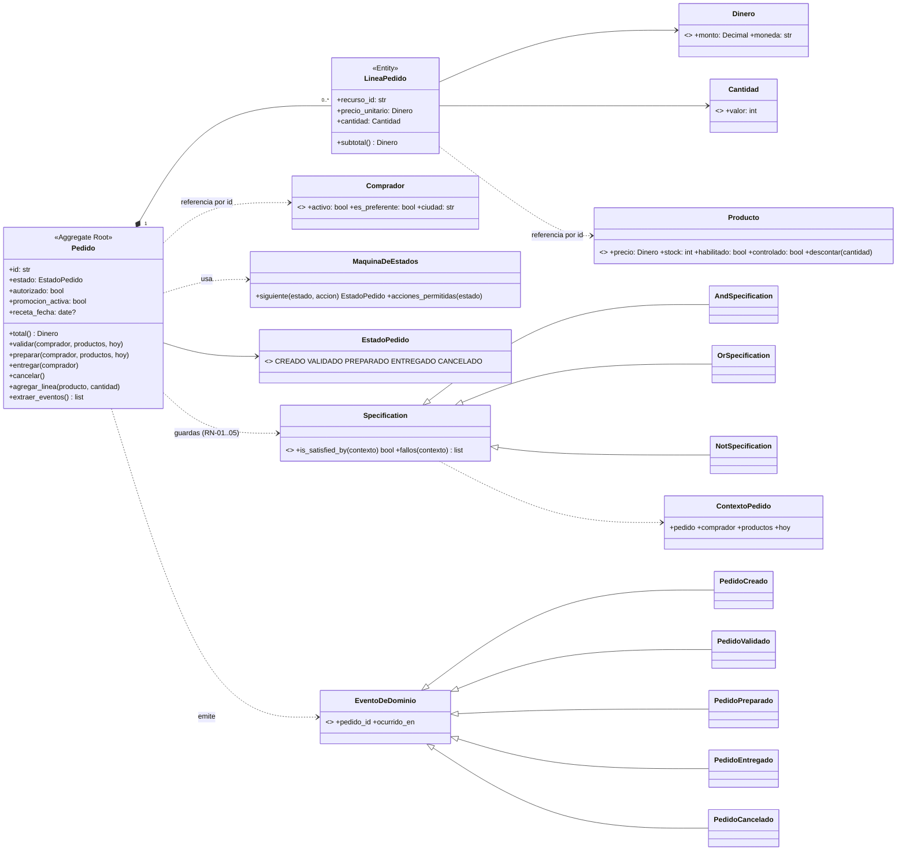
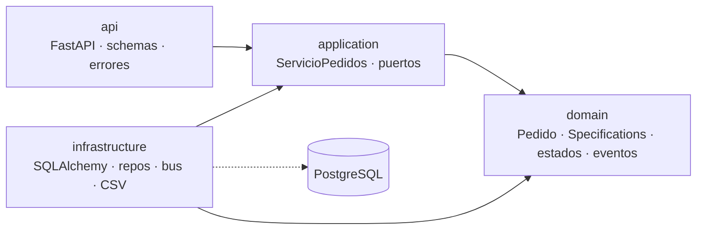
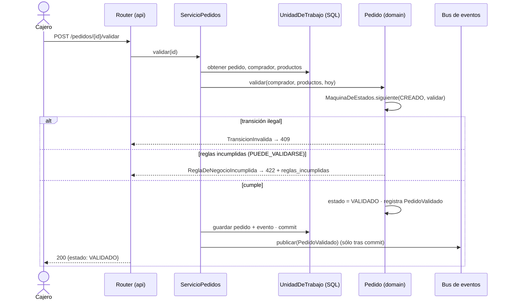
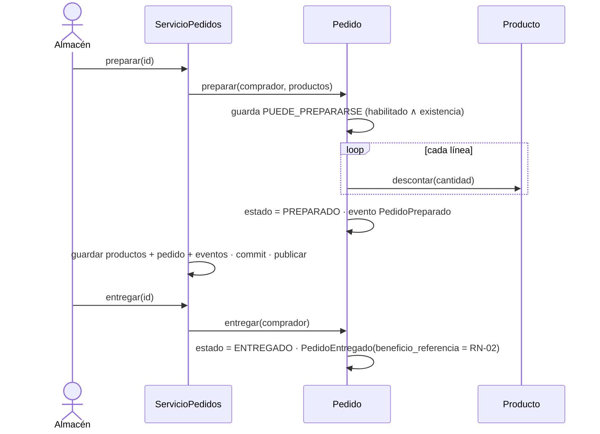

# Diagramas UML del código implementado (Mermaid; GitHub los dibuja directamente)

> Los diagramas de la U3 (`docs/u3/`) corresponden al diseño original de venta en mostrador con lotes.
> Estos describen **lo que está programado** en el incremento PIA (ver [BRD §9](BRD_final.md) y [ADR-005](adr/ADR-005-reconciliacion-modelo-pedido-vs-brd.md)).

## 1. Diagrama de clases — dominio

## 2. Capas y dependencias (ADR-001)

La regla (dominio no importa a nadie) la verifica `tests/test_arquitectura.py`.

## 3. Secuencia — validar un pedido (caso feliz y rechazo 422)

## 4. Secuencia — preparar y entregar (descuento de existencia)

## 5. Máquina de estados
Ver el diagrama de estados en [BRD §9.4](BRD_final.md) (RN-06) y [ADR-003](adr/ADR-003-maquina-de-estados-por-tabla.md).
